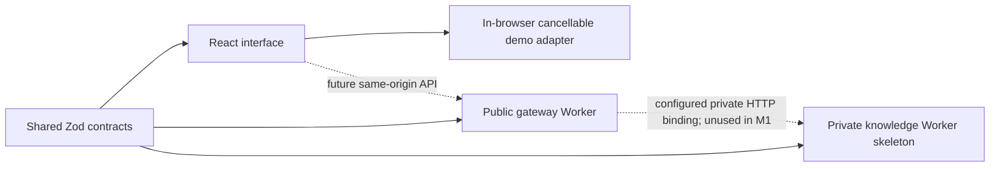

# Architecture and boundaries

## M2A local implementation

The gateway now contains the official MCP client; the private knowledge Worker
contains the official server with Cloudflare's HTTP handler adapter and D1. A
local-only private RPC diagnostic invokes the gateway client through a genuine
HTTP service binding. No public MCP/diagnostic HTTP route or frontend connection
was added. See [M2A details](m2a-mcp.md) for protocol evidence and trust boundaries.
The M1 design below is retained as the historical foundation.

## M1 implementation

The frontend makes no API or inference requests. Demo messages contain no candidate
facts. `requestDemoReply` is deliberately named and labeled as a local adapter;
future real services must be introduced through a separate boundary.

The typed reducer rejects stale completions by request ID. AbortController cancels
the timer adapter on Stop, Escape, reset, replacement and unmount. Message history
is bounded. All visitor text is rendered as React text nodes; no HTML interpretation.

Conversation states include idle, listening, processing, speaking, stopped and
error. Listening/speaking are reserved typed states; M1 never pretends to enter
them. Error handling is present even though the deterministic demo adapter has no
network dependency. Input limits and IME-safe Enter handling are enforced locally.

The gateway owns health and the future `/api/v1` boundary. The knowledge Worker
has no public routes, workers.dev endpoint or version-preview URL. The declared
HTTP service binding is private transport infrastructure only; it is unused in M1
and does not implement MCP. Neither Worker has a D1/Durable Object binding or key.

## Decisions

- npm workspaces: one lockfile and minimal build coordination.
- Strict TypeScript plus strict Zod objects at contract boundaries.
- React/Vite static output: no SSR needed for a conversation interface.
- CSS tokens: small, inspectable design system without a styling dependency.
- Shared system typography and inline SVG icons: no external font/image requests.
- Independently bundled Workers with separate preview/production binding names.
- No application auth, paid calls or database operations at this milestone.

The API returning 501 is a scope boundary, not an authorization system. Never add
paid operations before session, CSRF, quota and budget enforcement are implemented.

## Future approved architecture

The gateway orchestrator becomes a genuine official MCP client. The private Worker
adds the official MCP server and Streamable HTTP transport, approved D1 content,
read-only authorization and protocol tests. A Durable Object supplies atomic quota
and spending decisions. The launch strategy selects approved answer identifiers
and variants; no free-form candidate facts are generated. Synthetic preset speech
arrives in M4. Redis, vector databases, cloning and an admin dashboard are excluded.

## M2 gate

Before substantial agent code, prove the complete deployed private service-binding
path using a real MCP client: initialize, capability negotiation, tools/list,
tools/call, authorization failure, schema rejection and trace correlation. A direct
function call or ordinary REST JSON request does not satisfy this acceptance gate.
