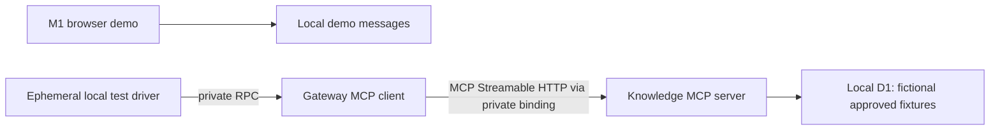

# M2A — genuine MCP, local verification only

Final results, the historical disk failure and the subsequent successful browser
closure are recorded in [M2A verification](m2a-verification.md). Local protocol
proof is complete. Strict verification passes, but C: headroom remains fragile.
[M2B deployment](m2b-b-verification.md) has now proved the real private binding path
in Cloudflare preview and retired its operator probe. Free CPU capacity still needs
follow-up. The remainder of this document preserves historical M2A scope/evidence.

No Cloudflare login, provisioning, deployment, paid operation, LLM, speech or M3
work is part of this milestone. **A deployed end-to-end proof remains M2B.**

## Versions and protocol

- Official `@modelcontextprotocol/client` **2.4.0** in the gateway.
- Official `@modelcontextprotocol/server` **2.4.0** in the knowledge Worker.
- Cloudflare `agents` **0.33.0**, imported only at `agents/mcp/server` for
  `createMcpHandler`. No Agent orchestration class/framework is used.
- Zod **4.6.7**, Wrangler **4.158.0**, Miniflare **5.20261104.0-beta** matching Wrangler.
- Pinned protocol **2025-11-25**, explicit legacy initialization mode. The newer
  per-request era is deliberately not automatically negotiated.



The test driver calls a **local-only private RPC** entrypoint, not a public HTTP
diagnostic on the gateway. That entrypoint starts the real SDK client, connects,
discovers tools and invokes one. The production gateway HTTP routes remain unchanged.

Verified message sequence: `initialize` → `notifications/initialized` → `tools/list`
→ `tools/call`. Tests assert the negotiated revision, tools capability, three
discoverable tools and actual results. A binding alone is not called MCP.

## Tools and contracts

Schemas are in `packages/mcp-contracts`. Every input/output object is strict.
Candidate identity comes from a verified capability and Worker configuration,
never a tool argument. IDs are bounded safe identifiers, not paths.

| Tool                       | Inputs                                                | Bounded output                                                                                  |
| -------------------------- | ----------------------------------------------------- | ----------------------------------------------------------------------------------------------- |
| get_candidate_profile      | version; 1–4 section enums                            | At most 12 approved public facts, each <=600 chars                                              |
| search_interview_knowledge | version; query <=500 chars; 1–4 kind enums; limit 1–5 | At most five public approved answer/project/story/evidence matches, summaries <=400 chars       |
| retrieve_approved_answer   | version; answerId; short/standard variant             | Exact approved text <=900 chars, SHA-256, 1–5 approved evidence items, <=5 public follow-up IDs |

Success metadata includes candidateId, contentVersion, synthetic flag and traceId.
Errors use sanitized codes with a retryable flag; missing/private/unapproved
answers have the same unavailable-content result. Internal SQL/stack traces are
not returned. Schema errors are produced by the real SDK, not handwritten RPC.

## Storage and fixtures

`apps/knowledge-mcp/migrations/0001_approved_knowledge.sql` defines candidates,
content versions, facts, projects, interview stories, evidence, approved answers,
variants, evidence links and follow-up links. Composite foreign keys preserve
candidate/version relationships. SQL views constrain publication/approval/visibility.

`tests/fixtures/fictional-knowledge.sql` is **explicitly fictional synthetic data**.
It includes two fictional subjects, draft/private/unapproved canaries and an
unapproved variant. No real candidate facts are assumed. Production rejects
synthetic versions even if ALLOW_SYNTHETIC_DATA is mistakenly true. At M2A handoff,
preview and production defaulted to UNCONFIGURED candidate/version and false fixture
flags. M2B-A now prepares fictional preview scope/fixtures with its operator probe
disabled; production remains unchanged. D1 IDs are placeholders, not cloud resources.

The local CLI migration and synthetic seed were executed with `--local`, persisting
under `.local/state/knowledge-mcp`. Tests independently create isolated ephemeral
local D1 databases; they do not depend on or mutate the developer database.

## Security controls

- No public knowledge route, workers.dev endpoint or version-preview URL in any env.
- Canonical internal URL and Host allowlist; all browser Origins are rejected.
- Per-request HS256 service capabilities: issuer, audience, candidate, environment,
  version, read scopes, issued/expiry times and jti. Validity is at most 60 seconds.
- A fresh credential is minted per transport request. WebCrypto verifies signatures.
- Same scoped key is required by both Workers; no hardcoded runtime default.
- Per-tool scope checks and published-version checks on every invocation.
- Parameterized read-only queries, closed schemas and bounded result validation.
- 8 KiB request cap; 16 KiB tool-data cap; 2-second tool and 2.5-second server
  deadlines; cancellable bounded gateway SDK operations.
- Structured client/server trace logs contain IDs, method, duration and outcome,
  not arguments, credentials, transcripts or evidence text. Responses carry trace IDs.
- Frontend artifact checks reject MCP secret identifiers and synthetic/private fixture
  markers. No fixture or server module is imported by the browser.

This is private service authentication, not a public OAuth MCP authorization server.
Read-only credentials can be replayed within their short lifetime if stolen; no
global replay ledger or distributed rate limiter is claimed. Cancellation discards
late read results; D1 cannot necessarily cancel a query it already accepted. These
limitations do not authorize paid endpoints or public agent functionality.

## Local commands

```powershell
Set-Location 'D:\Projects\voice-bot'
. .\scripts\dev-env.ps1
.\scripts\verify-env.ps1 -Strict
npm.cmd run check
npm.cmd run test:browser
```

One-time developer DB setup (already performed in this workspace):

```powershell
npm.cmd run mcp:local:init
npm.cmd run db:local:migrate
npm.cmd run db:local:seed
```

Key generation refuses to overwrite existing ignored `.dev.vars` files and never
prints key values. Do not rerun seed against an existing seeded database. Migration
apply is repeatable and tracks applied versions; do not delete state to reset it
without reviewing what is being removed. No remote command is part of these scripts.

Frontend preview is unchanged: `npm.cmd run dev`, then http://127.0.0.1:5173.
Screenshots remain under `.local/artifacts/playwright/preview-{1440,390,320}.png`.
Use `npm test` for the genuine local MCP proof; no public diagnostic endpoint is added.

## Running-test evidence and local limitations

Integration tests load actual bundled Workers, use the gateway's official MCP client
over a genuine workerd HTTP binding, and exercise local D1. External official-SDK
tests use an ephemeral relay Worker because Miniflare's Node getWorker proxy rewrites
Host to loopback. The relay restores the canonical internal request before crossing
a real HTTP binding. Production never allows loopback Hosts. This test-only bridge
is not deployed or part of the production source tree.

Coverage includes initialization/revision/capabilities, strict discovery, all three
tools, schema rejection, missing/invalid/expired auth, candidate/environment/scope/
version refusal, draft/private/unapproved answers, revocation, production fixture
refusal, eight parallel isolated clients, traces, client cancellation/deadline and
a stalled-upload server deadline with an official SDK client. M1 UI/runtime tests
are retained; its obsolete unauthenticated /mcp expectation now tests Host rejection.

Miniflare proves local runtime compatibility, not deployed routing, account limits,
secret configuration, D1 regional behavior, external TLS or cloud CPU limits. The
newest MCP era, public third-party clients, OAuth, subscriptions and reconnecting
session transports are outside M2A. No deployed proof is claimed.

## M2B resources and permissions — approval required

Required preview-only resources: two Worker scripts, one D1 database, a private HTTP
service binding, environment-scoped secrets/configuration, and a controlled temporary
operator probe if needed. Production remains untouched. No Redis, Durable Object,
vector database, inference provider or paid API is needed for this protocol proof.

Owner authentication must be explicitly approved first. Under current granular
Workers authorization, creating new Workers requires **Workers product Admin**
scoped to the selected account; existing Workers can then be managed with scoped
**Editor** access. Have the owner create the named preview Workers or use a temporary
creation grant, then reduce deployment access to those specific Workers. D1 creation
and migration need **D1 Edit / D1 Write** for that account. Legacy token interfaces
list Workers Scripts Edit; verify the token's effective creation rights rather than
assuming Editor can create new Workers. Read-only log access is optional for
correlated cloud evidence. No zone/routes permission is
needed when retaining private knowledge and a workers.dev gateway; a custom domain
would require separately approved zone configuration.

M2B must replace D1 placeholders with the actual preview ID, use new preview-only
secrets (never local keys), migrate and seed **only approved synthetic preview data**,
and explicitly enable its fixture flag while keeping production blocked. The
local-only diagnostic cannot simply be exposed in preview: implement a separately
reviewed, authenticated operator probe with short-lived access and remove it after
verification. Check account/CPU limits first. Any paid-plan change requires a
separate approval; do not promise the SDK fits the Free plan's CPU budget unmeasured.

Capture negotiated revision, discovery/call evidence, private-route inaccessibility,
auth failures and trace correlation in the actual deployment. Only then may M2B be
reported complete. No M3 work follows automatically.

Official permission references:
[Workers roles](https://developers.cloudflare.com/workers/authorization/workers/),
[API token permissions](https://developers.cloudflare.com/fundamentals/api/reference/permissions/),
[D1 creation](https://developers.cloudflare.com/api/resources/d1/subresources/database/methods/create/).
